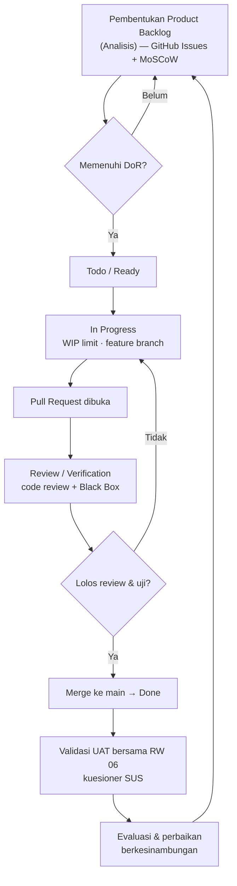

# §3.5 Mekanisme Perancangan — Status Porting ke Docx

> **Status terverifikasi (19 Okt 2026, pengecekan langsung ke `Capstone_Kelompok_30.docx`):**
> §3.5 versi Kanban **sudah ada di dua tempat sekaligus** —
> (a) `docs/laporan/laporan.md` §3.5.1–§3.5.5, dan
> (b) **di dalam docx itu sendiri**, termasuk **Tabel 11–13**.
> Jadi §3.5 **tidak perlu ditulis ulang / dipindahkan lagi**. Sisa satu-satunya pekerjaan isi
> adalah **gambar flowchart §3.5.1** (lihat §2.1).

---

## 1. Apa yang sudah ada di `laporan.md` §3.5

| Sub-bab | Isi di `laporan.md` | Bentuk wajib panduan | Status |
|---|---|---|---|
| 3.5.1 Sistematika | 6 tahap aliran Kanban (Backlog → Todo/Ready → In Progress → Review/Verification → Done → UAT) | **Flowchart** + narasi | ⚠️ narasi ada, **flowchart belum** |
| 3.5.2 Pengumpulan Data | **Tabel 11** — 5 baris (regulasi, observasi, studi berkas, kebutuhan/MoSCoW, infrastruktur) | Tabel | ✅ ada di `.md` & docx |
| 3.5.3 Verifikasi & Validasi | 3.5.3.1 verifikasi (fungsional, validasi masukan, kontrol akses, keamanan OWASP) · 3.5.3.2 validasi (mitra, UAT+SUS, kepatuhan regulasi) | Narasi | ✅ ada di `.md` & docx |
| 3.5.4 Jadwal | **Tabel 12** — 11 aktivitas, Minggu 1–16 | Tabel | ✅ ada di `.md` & docx |
| 3.5.5 Komponen Sistem Terintegrasi | **Tabel 13** — 5 unsur (Manusia/Material/Mesin/Informasi/Energi) × As-Is/To-Be/Manfaat | Tabel | ✅ ada di `.md` & docx |

**Mitra & regulasi sudah konkret di `laporan.md`:** RW 06 Kelurahan Kota Baru, Kecamatan Bekasi Barat ·
UU 6/2014 · Permendagri 18/2018 · **Perwali Bekasi 58/2020** · UU PDP 27/2022 · UU Adminduk 24/2013.

---

## 2. Yang Masih Kurang untuk Lolos Panduan

### 2.1 Flowchart §3.5.1 (WAJIB — satu-satunya gap isi)

**Prompt Visual Paradigm AI siap tempel:** `diagram-prompts.md` §1.

Panduan meminta **diagram alir** di 3.5.1. Belum ada di mana pun. Gambar ini perlu dibuat sebagai
**gambar** di Word (caption `Gambar 7`, melanjutkan Gambar 1–6), bukan blok kode. Draf mermaid di bawah
bisa diekspor (mermaid.live / draw.io) lalu disisipkan:

### 2.2 Penomoran tabel — sudah konsisten (tidak perlu apa-apa)

Tabel di §3.5 sudah bernomor **Tabel 11 (Mekanisme), Tabel 12 (Aktivitas), Tabel 13 (Pemetaan)** di
**kedua** dokumen, meneruskan Tabel 6–10 (SF modul) di §3.3.4. Tidak ada renumbering.

> Catatan Word: *field* **DAFTAR TABEL** di docx kadang masih menampilkan nomor/judul versi lama
> (berbasis aktor) karena cache belum disegarkan. **Badan dokumen sudah benar** — cukup klik kanan →
> *Update Field* (atau F9) pada Daftar Tabel/Daftar Gambar untuk menyegarkan cache.

### 2.3 Tidak ada "narasi generik" yang perlu diganti

Klaim bahwa docx masih memuat narasi sebagai 8 langkah generik **tidak terbukti** saat pengecekan
langsung. Docx sudah memuat versi Kanban yang sama dengan `laporan.md`.

---

## 3. Catatan Kejujuran (§3.5.1)

Papan Kanban berdiri **setelah** sebagian modul berkembang (sebagian kartu di-*back-fill* dengan bukti
kode). Ini perlu dinyatakan apa adanya di narasi/Bab IV §4.1 — jangan mengarang tanggal pengerjaan.
Draf penyelarasan ada di `docs/arsip/laporanRevisi.md`.

---

## 4. Catatan Sinkronisasi dengan Docx

- **Isi §3.5 = bebas konflik.** `laporan.md` dan docx sudah sama.
- Satu-satunya selisih isi yang ditemukan antara `.md` dan docx ada di **§3.1 (ruang lingkup)**; docx
  lebih baru (koreksi ruang lingkup sudah masuk ke docx) dan **sudah diselaraskan** ke `laporan.md`.
- Sisa pekerjaan manual manusia: **F9/Update Field** untuk Daftar Tabel & Daftar Gambar di Word, dan
  pembuatan **gambar flowchart §3.5.1**.
