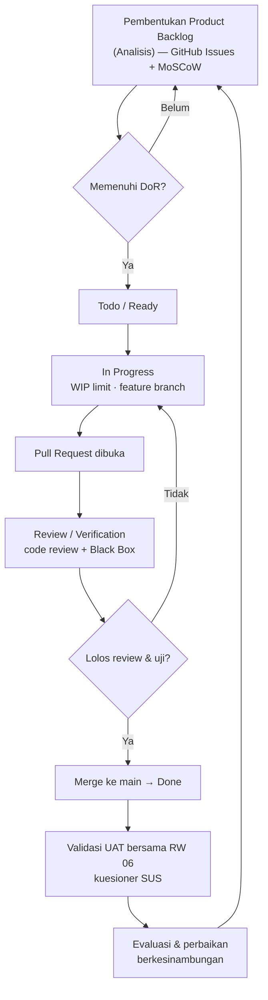

# §3.5 Mekanisme Perancangan — Status Porting ke Docx

> **Temuan penting (19 Okt 2026):** §3.5 versi Kanban **sudah lengkap** di
> `docs/laporan/laporan.md` (baris 509–585) — 3.5.1–3.5.5 + **Tabel 11–13**.
> Jadi ini **bukan** pekerjaan menulis dari nol, melainkan **memindahkan + merapikan**
> dari `laporan.md` ke `Capstone_Kelompok_30.docx`.
>
> Docx saat ini masih memuat **narasi generik** di §3.5 (tanpa Kanban, tanpa tabel) → harus diganti.
> Disusun: 19 Okt 2026.

---

## 1. Apa yang sudah ada di `laporan.md` §3.5

| Sub-bab | Isi di `laporan.md` | Bentuk wajib panduan | Status |
|---|---|---|---|
| 3.5.1 Sistematika | 6 tahap aliran Kanban (Backlog → Todo/Ready → In Progress → Review/Verification → Done → UAT) | **Flowchart** + narasi | ⚠️ narasi ada, **flowchart belum** |
| 3.5.2 Pengumpulan Data | **Tabel 11** — 5 baris (regulasi, observasi, studi berkas, kebutuhan/MoSCoW, infrastruktur) | Tabel | ✅ siap |
| 3.5.3 Verifikasi & Validasi | 3.5.3.1 verifikasi (fungsional, validasi masukan, kontrol akses, keamanan OWASP) · 3.5.3.2 validasi (mitra, UAT+SUS, kepatuhan regulasi) | Narasi | ✅ siap |
| 3.5.4 Jadwal | **Tabel 12** — 11 aktivitas, Minggu 1–16 | Tabel | ✅ siap |
| 3.5.5 Komponen Sistem Terintegrasi | **Tabel 13** — 5 unsur (Manusia/Material/Mesin/Informasi/Energi) × As-Is/To-Be/Manfaat | Tabel | ✅ siap |

**Mitra & regulasi sudah konkret di `laporan.md`:** RW 06 Kelurahan Kota Baru, Kecamatan Bekasi Barat ·
UU 6/2014 · Permendagri 18/2018 · **Perwali Bekasi 58/2020** · UU PDP 27/2022 · UU Adminduk 24/2013.

---

## 2. Yang Masih Kurang untuk Lolos Panduan

### 2.1 Flowchart §3.5.1 (WAJIB — satu-satunya gap isi)

**Prompt Visual Paradigm AI siap tempel:** `diagram-prompts.md` §1.

Panduan meminta **diagram alir** di 3.5.1. Belum ada di mana pun. Gambar ini perlu dibuat sebagai
**gambar** di Word (caption `Gambar 3.1`), bukan blok kode. Draf mermaid di bawah bisa diekspor
(mermaid.live / draw.io) lalu disisipkan:

### 2.2 Rapikan penomoran & judul

- `laporan.md` masih pakai anotasi internal di judul: **"3.5.4. Jadwal Pelaksanaan Perancangan
  (Penyesuaian Penomoran)"** dan **"3.5.5. Identifikasi Komponen Sistem Terintegrasi (Format Standar 5
  Unsur)"** → hapus tanda kurung saat masuk docx.
- Tabel 11–13 harus dinomori ulang mengikuti urutan tabel di docx (§3.3 sudah memakai Tabel 3.1–3.5).
  Jadi kemungkinan besar menjadi **Tabel 3.6, 3.7, 3.8** — cek dulu nomor terakhir di §3.3.

### 2.3 Ganti narasi generik di docx

Hapus narasi §3.5 lama di docx yang berbunyi "Identifikasi Kebutuhan → Perancangan Data → Arsitektur →
UI/UX → Keamanan → Modul → Integrasi → Pengujian" (tanpa menyebut Kanban) dan ganti dengan versi
`laporan.md`.

---

## 3. Catatan Kejujuran (§3.5.1)

Papan Kanban berdiri **setelah** sebagian modul berkembang (sebagian kartu di-*back-fill* dengan bukti
kode). Ini perlu dinyatakan apa adanya di narasi/Bab IV §4.1 — jangan mengarang tanggal pengerjaan.
Draf penyelarasan ada di `docs/arsip/laporanRevisi.md`.

---

## 4. Yang Perlu Dikonfirmasi

- `[[KONFIRMASI]]` Apakah §3.5 di docx ditulis **persis** seperti `laporan.md` (lalu `laporan.md`
  dianggap final), atau perlu disunting ulang bersama Zidan?
- `[[KONFIRMASI]]` Siapa yang menyediakan **gambar flowchart** final (Afif ekspor mermaid, atau dibuat
  di draw.io)?
